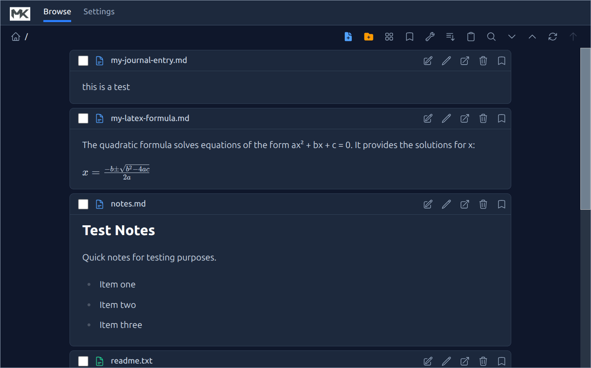

# KoCreator

A video authoring tool that converts a directory of screenshots and narration (text files) into demo videos. Point it at a folder of numbered `.png` images and `.txt` narration scripts and it produces both an **MP4** (with AI-generated voice narration) and an **animated GIF**.

KoCreator itself contains no text-to-speech code. Speech comes from a **TTS plugin**: a folder, normally checked out next to this one, that holds a `tts.sh` script with a small fixed interface. Swapping TTS engines means pointing KoCreator at a different plugin folder; nothing else changes.

## Demo Output

All of these [MkBrowser Demo Videos](https://clay-ferguson.github.io/videos) were generated by KoCreator, from screenshots and narration files. The MkBrowser screenshots that were used to generate those videos all originated from running Playwright tests, and letting Playwright output those screenshots. However, of course as far as KoCreator is concerned it doesn't know where the screenshots came from, it just makes videos out of the screenshots and narration files.

The animated GIF and MP4 below were also generated by the `test-generate.sh` script from the test screenshots and narration files in `test/screenshots/create-mermaid-demo/`.

### Animated GIF

Example GIF created by KoCreator



### MP4 Video (with narration audio)

[Example MP4 Generated by KoCreator](https://clay-ferguson.github.io/videos/create-mermaid)

## TTS Plugins

| Plugin folder | Engine | Also needs | Status / notes |
|---|---|---|---|
| [`kocreator-kokoro`](../kocreator-kokoro) | [Kokoro](https://github.com/hexgrad/kokoro) (Apache 2.0) | nothing | **Supported** (batch). Self-contained; its own uv venv. Supports `[word](/phonemes/)` pronunciation overrides. The default. |
| [`Buffy`](https://github.com/Clay-Ferguson/Buffy) | [Underdog Woof](https://huggingface.co/ConwayResearch/Underdog-Woof) | nothing | **Supported** (batch). Buffy is a plugin itself (its `tts.sh`). Fast on CPU (numpy only); supports per-clip `.seed` re-rolls. Non-commercial license. |
| [`kocreator-qwen`](../kocreator-qwen) | [Qwen3-TTS](https://github.com/QwenLM/Qwen3-TTS) | nothing | **Supported** (batch). Self-contained; its own uv venv. Supports per-clip `.seed` re-rolls. Slow on CPU; best on an NVIDIA GPU. |

A typical layout, with every folder a sibling:

```
projects/
  kocreator/              ← this project
  kocreator-kokoro/       ← plugin, self-contained
  Buffy/                  ← plugin (Underdog Woof), self-contained
  kocreator-qwen/         ← plugin (Qwen3-TTS), self-contained
```

You only need the plugin you use (plus whatever that plugin needs).

### Choosing a Plugin

The plugin is set in [`kocreator.toml`](kocreator.toml):

```toml
tts_plugin = "../kocreator-kokoro"
```

A relative path is resolved against the kocreator folder; an absolute path works too. For a single run you can override it, in order of precedence, with the `--plugin DIR` flag or the `KOCREATOR_TTS_PLUGIN` environment variable:

```bash
uv run create-video.py <base-folder> <subfolder-name> --plugin /path/to/another-plugin
KOCREATOR_TTS_PLUGIN=/path/to/another-plugin ./test-generate.sh
```

Voice settings (voice, speaker, temperature, …) belong to each plugin and live as variables at the top of its `tts.sh`.

### Writing a TTS Plugin

A plugin is any folder containing an executable `tts.sh` that answers three subcommands:

| Call | Must do |
|---|---|
| `tts.sh check` | Exit 0 when the engine is installed and ready. Otherwise print how to set it up and exit non-zero. KoCreator calls it once per run, before speaking anything, and shows its output on failure. |
| `tts.sh settings` | Print **one JSON object** to stdout describing every setting that shapes the audio (engine, voice, model, temperature, …). KoCreator stores it in each clip's cache manifest, so changing any value here regenerates every narration on the next run. |
| `tts.sh speak <jobs.tsv>` | Speak every job in the jobs file, in order, loading the engine **once**. After writing each job's WAV, print the line `KOCREATOR_DONE <n>` to stdout, where `n` is the 1-based job number. Exit 0 when all jobs are done. |

Speaking is **batch-only**: there is no single-file call, and one clip is simply a batch of one. KoCreator gathers every narration that isn't cached and makes one `speak` call for the whole run.

The jobs file is UTF-8 text with one job per line and three tab-separated fields:

```
<input.txt>	<output.wav>	<seed>
```

- `input.txt` is the absolute path of a narration file to speak.
- `output.wav` is the absolute path of the WAV to write.
- `seed` is a whole number, or empty when the narration has no `.seed` sidecar. An engine without seeds should print a note and ignore it.

The `KOCREATOR_DONE <n>` markers are how KoCreator follows progress. Each marker finishes that clip on the spot: the WAV is moved into the cache, and everything the plugin printed (stdout and stderr) since the previous marker is saved as that clip's `.log`. So the first clip's log also holds the engine's start-up output. Markers must come in order, one per job, each after its WAV is completely written. A plugin that writes in Python should flush stdout on every line (for example with `sys.stdout.reconfigure(line_buffering=True)`); otherwise the markers arrive late, all at once.

What KoCreator guarantees when calling the script:

- **A clean uv environment.** `UV_PROJECT_ENVIRONMENT` and `VIRTUAL_ENV` are removed, so a plugin's own `uv run` uses the plugin's (or its engine's) virtualenv, never KoCreator's.
- **Thread budget.** `KOCREATOR_THREADS` is always set to the CPU thread budget. Unless `HIGH_PERFORMANCE` is on, `OMP_NUM_THREADS`, `MKL_NUM_THREADS` and `OPENBLAS_NUM_THREADS` are set to the same value too (or `--threads N`). KoCreator's lowered `nice` priority is inherited.
- **Atomic output.** Each `<output.wav>` is a temporary `….partial.wav` path, renamed into place only when its marker arrives. If the plugin fails partway (non-zero exit, or it stops before every marker arrives), KoCreator stops and shows the output for the clip that failed. Clips finished before the failure stay cached, so the next run picks up where this one stopped. KoCreator also stops the plugin if KoCreator itself exits early (Ctrl-C).

`kocreator-kokoro` is the reference implementation: `tts.sh` calls `kokoro-batch.py`, which loads Kokoro once and works through the jobs file.

## How It Works

Create a folder of interleaved screenshots and narration files, ordered by numeric prefix:

```
screenshots/my-demo/
  001-welcome.png
  002-narration.txt          ← converted to speech by the TTS plugin
  003-next-screen.png
  004-explanation.mp3        ← or use pre-recorded audio (.mp3 / .wav)
  005-final.png
```

- **`.png`**: displayed as a still frame for 2 seconds (configurable).
- **`.txt`**: converted to WAV audio by the TTS plugin; the most recent screenshot is held on screen for the duration of the narration.
- **`.mp3` / `.wav`**: used directly as audio; the most recent screenshot is held on screen.

Files are processed in filename order. The first file must always be a `.png` screenshot.

Generated TTS audio is cached in a `generated-wav/` subfolder next to the source files. Each `<name>.wav` there has two files beside it. `<name>.json` is a manifest recording a hash of the narration text, the clip's seed (if any) and the plugin's `settings`. `<name>.log` holds the plugin's output for that clip. A cached WAV is reused only when its manifest matches the current text, seed and settings exactly. So editing a narration, changing a voice or switching plugins regenerates just what is affected, and a WAV without a manifest (from another tool, or an interrupted run) is always regenerated. Deleting `generated-wav/` forces a full regeneration. The cache key doesn't include the engine's own version, so after upgrading an engine, delete the `generated-wav/` folders.

### Re-rolling a Clip

On engines that support seeds (`Buffy` and `kocreator-qwen`), a glitchy clip can be regenerated on its own with a different seed. Put a whole number in a `.seed` file named like the narration file, next to it:

```
screenshots/my-demo/
  004-narration.txt
  004-narration.seed         ← contains e.g. 3
```

The seed is part of the cache key, so on the next run only that clip is regenerated (its progress line shows `(seed 3)`). Try other numbers until it sounds right. Deleting the `.seed` file goes back to the plugin's default. It works in `intro/` too. A `.seed` file that doesn't contain a whole number stops the run with an error naming it.

## Splashscreen / Intro

You can prepend a shared intro (e.g. a branded splash screen) to every MP4 you produce without copying files into each demo folder. Place the intro assets in a folder named `intro/` **alongside** your demo folders:

```
screenshots/
  intro/                     ← shared intro assets (sibling of your demo folders)
    000-splash.png
    001-splash-narration.txt
  my-demo/
    001-welcome.png
    002-narration.txt
    ...
```

When `create-video.py` runs, it automatically detects the `intro/` sibling folder and prepends its files, sorted by filename, to the beginning of the MP4. The intro files are sorted separately from the main demo files, so they never interleave: all intro files come first (in their own order), followed by all demo files (in their own order).

A few details:

- **MP4 only**: intro files are included in the MP4 but are **not** added to the animated GIF.
- **Same file types**: the intro folder supports the same `.png`, `.txt`, `.mp3`, and `.wav` files as a normal demo folder.
- **TTS caching**: narration `.txt` files in `intro/` are converted to speech and cached in `intro/generated-wav/`, independent of the main demo's cache.
- **First file rule**: the first file across intro + demo must still be a `.png` (which it will be naturally if your intro starts with a splash image).
- **Skip the intro**: pass `--no-intro` to omit the intro folder for a single run:

```bash
uv run create-video.py <base-folder> <subfolder-name> --no-intro
```

## Setup

1. Install [uv](https://docs.astral.sh/uv/) if you don't have it: `curl -LsSf https://astral.sh/uv/install.sh | sh`
2. Check out a plugin next to this folder and run its own `./setup.sh` (and set up whatever it needs; see its README).
3. Point [`kocreator.toml`](kocreator.toml) at that plugin, then run this project's setup:

```bash
./setup.sh                        # or: ./setup.sh --plugin <dir>
```

`setup.sh` installs `ffmpeg` via apt, syncs this project's (empty) Python environment with uv, runs the plugin's `tts.sh check`, and speaks one sentence through the plugin into `test_output.wav` as a smoke test.

**System requirements:** Ubuntu Linux and uv. You don't need a particular Python installed: `.python-version` pins 3.12, and uv downloads that interpreter into its shared store if your machine lacks it.

The project virtualenv is **per machine**: `.venv-<hostname>/` (gitignored). A uv venv only works on the machine that built it, because `bin/python` is a symlink into that machine's uv interpreter store. So if this folder is shared between machines (for example a host and a VM mounting the same disk), one shared `.venv/` would break for whichever machine didn't build it last. `uv-env.sh` sets `UV_PROJECT_ENVIRONMENT` to `.venv-<hostname>`, and `setup.sh` and `test-generate.sh` source it, as do callers like MkBrowser's `playwright-test.sh`. You never need to activate the venv. Before running `uv` by hand, source the helper so `uv` uses this machine's venv rather than creating a plain `.venv/`:

```bash
source uv-env.sh
```

An existing `UV_PROJECT_ENVIRONMENT` in your environment takes precedence.

### Dependencies

`create-video.py` uses only the Python standard library. Video work is done by the `ffmpeg`/`ffprobe` binaries, and speech by the plugin in its own environment. So `pyproject.toml` declares no dependencies, and uv is used only to run the script on the pinned Python. `uv.lock` records that (empty) set, so a fresh `./setup.sh` (`uv sync --locked`) reproduces it. TTS engines and their dependencies are upgraded in their plugin folders, not here.

Should a dependency ever be added:

1. Add it to `dependencies` in `pyproject.toml`, pinned to the tested version.
2. Re-resolve, install, and test:

```bash
uv lock                # re-resolve; other locked versions are kept where possible
uv sync                # bring this machine's venv in line with the new lock (after `source uv-env.sh`)
./test-generate.sh     # confirm TTS and video output still work
```

3. Commit `pyproject.toml` and `uv.lock` together.

## Usage

```bash
uv run create-video.py <base-folder> <subfolder-name> [--plugin DIR] [--no-intro] [--threads N]
```

The script looks for media files in `<base-folder>/screenshots/<subfolder-name>/` and writes output to `<base-folder>/test-videos/`:

- `<subfolder-name>.mp4`: full video with audio narration
- `<subfolder-name>.gif`: animated GIF of the screenshots (no audio)

## Video Format / Browser Compatibility

The MP4 is encoded for playback in every current browser on every platform,
without a WebM fallback:

| Property | Value | Why |
|---|---|---|
| Container | MP4, `+faststart` | `moov` atom first, so playback starts before the file finishes downloading |
| Video codec | H.264 **High** profile, **level 4.0**, 8-bit `yuv420p` | The only codec decoded natively by every browser and OS. High profile 4:2:0 is universally supported; Baseline/Main would cost quality for no compatibility gain |
| Resolution | One fixed canvas for the whole file, capped at 1920×1080 | **The important one**; see below |
| Pixel aspect ratio | 1:1 (`setsar=1`) | Square pixels, so no player second-guesses the display aspect |
| Frame rate | Constant 30 fps | A constant rate keeps `-c copy` concatenation valid; every screenshot change is already a keyframe, so seeking stays accurate |
| Colour | BT.709 primaries/transfer/matrix, limited (`tv`) range, tagged **and** converted as such | Untagged streams are guessed at, and browsers guess differently; this keeps colours identical everywhere |
| Audio codec | AAC-LC, 44.1 kHz, **mono**, 64 kbps | The universal web audio baseline. Mono is as universally decodable as stereo, and narration is mono at the source, so stereo only spent bits duplicating a channel |

**Why a single fixed resolution matters.** The final MP4 is assembled by
concatenating per-screenshot segments with `-c copy`. An MP4 records the video
resolution once, in the container header, taken from the first segment. If a
later segment has a different resolution, the resulting file still plays under
permissive software decoders (ffmpeg, mpv, Chrome on Linux) but hardware
decoders (Safari, Chrome/Edge on Windows, Firefox on most platforms) stop
producing frames at the switch. The symptom is **audio plays but the video is
blank**.

Screenshots routinely differ in size (a branded intro splash versus app
captures, or captures taken at different window sizes). So `create-video.py`
picks one canvas up front: the most common screenshot size, scaled down if
needed to stay within 1920×1080. It then scales and letterboxes every other
frame onto it. Screenshots are never upscaled, which would blur text. When sizes differ the
script prints a notice naming them.

Before concatenating, the script probes every segment and refuses to continue
unless they all share identical stream parameters, so a regression fails loudly
instead of producing a file that only plays on your own machine.

All of the above lives in the constants block near the top of `create-video.py`
(`TARGET_FPS`, `MAX_WIDTH`, `MAX_HEIGHT`, `H264_PROFILE`, `H264_LEVEL`, …).

## Test Data

The `test/` directory contains a built-in demo (`create-mermaid-demo`) with 9 screenshots and 9 narration scripts, plus a shared `intro/`. Use it to verify your installation or as a reference for structuring your own content.

Run the included test script to generate both video formats from the demo data (extra arguments go to `create-video.py`):

```bash
./test-generate.sh
./test-generate.sh --plugin <dir>
```

Output will appear in `test/test-videos/`.

## Files

| File | Purpose |
|------|---------|
| `create-video.py` | Main application: builds MP4 and GIF videos from screenshots and narration |
| `kocreator.toml` | Configuration: which TTS plugin folder to use |
| `pyproject.toml` | Project metadata; no Python dependencies (speech runs in the plugin) |
| `uv.lock` | Exact resolved versions of every Python package, installed by `setup.sh` |
| `.python-version` | Python version uv uses for the project (3.12) |
| `uv-env.sh` | Sourced helper that points `UV_PROJECT_ENVIRONMENT` at the per-machine venv `.venv-<hostname>` |
| `setup.sh` | One-time setup: installs ffmpeg, syncs the venv with uv, checks the plugin and runs a smoke test through it |
| `test-generate.sh` | Runs `create-video.py` against the built-in test data in `test/` |

To speak text files outside of a video, call a plugin directly with a jobs file (one `input<TAB>output<TAB>seed` line per file; leave the seed empty):

```bash
printf '%s\t%s\t\n' "$PWD/input.txt" "$PWD/output.wav" > jobs.tsv
../kocreator-kokoro/tts.sh speak jobs.tsv
```

## License

KoCreator's own code is not tied to any TTS engine. The license of the generated narration depends on the plugin's engine. Kokoro is Apache 2.0. Underdog Woof is under the Underdog Non-Commercial License 1.0: free for personal use with credit, while commercial use needs a license from Underdog. See each plugin's README.
